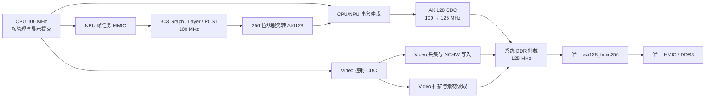

# B03 NPU 主工程集成设计提案

日期：2026-10-30。工作位置：`D:/FPGA/TriHaRiscv-main`。

本轮完成远端状态核对和集成规划，未迁入产品 RTL、修改硬件 ABI 或执行新的仿真、PDS、板测。用户已明确选择：**NPU 自主执行完整网络及解码/NMS；CPU 管理帧、选择头像并提交显示。** 后续直接在本主工程实施，沿用当前工作分支，不另建长期工程或切换共享目录分支。

## 1. 基线与已核对事实

通过 Windows 系统代理及现有 Git Credential Manager 身份执行 fetch，并用 ls-remote 独立确认：

- 上游 HEAD/main：`558280b30219acdcf9f962acd6e907e0f680ab52`，2026-10-30 19:42:47 +08:00。
- B03 源码检查点：`580174a493f615cd2308e92ae0f429de70a21422`。
- 主工程 HEAD：`18d4c4cca82e5dc7dd7c687f23387fefe90a2c54`。
- 本地 `D:/FPGA/npu_zgtc` 工作文件及未提交台账保持原样；只更新远端引用。

| 范围 | 当前可复用内容 | 尚未成立的结论 |
|---|---|---|
| 上游 B03 | 79 算子整网、16×16 阵列、FPGA 解码/NMS/坐标恢复；完整帧及六图历史功能证据 | 没有 B03 位流、整机最终 STA 或板上性能结果；最新 163 候选不能复用旧 Graph 六图证明 |
| 上游 B02 | 综合自检位流、100/125 MHz 实现及用户转述符合预期 | 原始现场 UART 明细未归档；不能代替 B03 整网板测 |
| 主工程 NPU | 单算子 MMIO/DMA、Dense/DW、47 层×3 输入逐层对照 | 旧标量路径不作为 B03 的生产计算核心 |
| 主工程 Video | 800×600 连续 RAW/BOX/AVATAR、320×320 BGR NCHW 输入、板级 HMIC/HDMI | 当前板级框点为夹具，自动 A/B 轮转没有 NPU 持有期 |
| CPU | 独立 CPU/cache/DDR/CDC 及真实 100 MHz 板测证据 | 主工程 `rtl/cpu/` 仍只有占位；当前 CPU 工作树有未提交改动，需要按证据选源 |
| 系统 | CPU→Video、CPU→旧 NPU、Video 共享 DDR 的分项联测 | 没有正式 CPU/NPU/Video 共用 fabric、跨主端可见性与整机恢复证明 |

上游 runtime 清单列出 68 个输出条目，Git 中该目录仅提交清单，68 个条目在声明的包路径均缺失。这些输出需从已提交数值资产、已有本地冻结输入重建并核对 SHA；天然图像输入不能以新随机图替换后沿用旧通过记录。

上游完整帧代理仿真记录冷/暖帧 9,578,901 / 9,112,373 周期，100 MHz 对应约 95.789 / 91.124 ms。它们是特定输入和代理内存的仿真数据，尚未满足主工程有效输出 ≥24 fps 的优化目标，也不是板上吞吐。上游 30 fps 目标不自动改写主工程验收口径。

来源与哈希：[审查证据](../../verification/npu/2026-10-30-upstream-integration-audit.json)。关键上游规格为固定提交中的 word/93、95、160、163、164；README 的历史段落按日期解释。

## 2. 方案取舍

| 方案 | 影响 | 决定 |
|---|---|---|
| 提取 B03 整网/POST 核心，增加主工程控制和存储适配 | 保留数值成果与 FPGA 调度，复用现有 Video DDR，需验证新接口 | **采用，用户已确认职责** |
| 继续 CPU 逐算子并做解码/NMS | 需重做调度/后处理，不能直接复用 B03 整帧闭环 | 保留旧算子端点作回归，不作为本轮生产路线 |
| 整个 B03 UART/PLL/HMIC 诊断顶层与 Video 并接 | 重复 DDR 所有者、复位监督和存储资源，scope0 仍未解决 | 不采用 |

首个功能里程碑为真实 bbox 同帧显示；最终五点关键点要求保留，独立安排模型、量化、算子表、结果格式及质量验证。bbox 阶段必须显式报告 `landmarks_valid=0`，不能用既有人工五点充当检测结果。

## 3. 目标结构

CPU/NPU 使用同一根实际 100 MHz，DDR/Video core 保持 125 MHz，显示像素 40 MHz，自由监督 27 MHz。优先让 CPU/NPU 在 100 MHz 仲裁后共用 AXI128 CDC，降低重复 FIFO；此选择需测 CPU 等待和 NPU 服务时间，不能直接继承 CPU 独占 DDR 的时序结论。

B03 `b03_frame_exec_payload` 暴露 MODEL 块服务与 POST CMD/W/R/DONE 两套边界。保留并审查 `b03_block_dma`、`b03_phase_mem_mux_burst` 的所有者/身份语义，把统一 256 位服务转换为 AXI128。生产 filelist 不接入 B03 独占 native bridge、UART 下载外壳及其私有 HMIC 自动复位权限。

采用有完整证据的 payload/v12 相关功能闭包作为导入候选，先重建显式清单和本地证据。163/fo128 是未完成同源六图审核的候选，不能仅因文件较新就被选作已验证生产基线。面积优化后的最终闭包必须重新跑同源回归。

## 4. 必须冻结的接口

### 4.1 控制与身份

生产 NPU 仍占 `0x20000000/4KiB`，新增独立 frame ABI 的 ID/version/capabilities；旧 `npu_regs.json` 及其算子目标保持可回归，两个 ABI 不在同一地址同时实例化，也不复用旧字段表达新语义。

CPU 写入完整 shadow 任务，START 原子锁存；BUSY 或未 ACK 完成时拒绝覆盖。完成快照包含 cmd_id、frame_id、generation/epoch、状态、结果范围/数量/CRC、model/post/total 周期。DONE/ERROR sticky，ACK 必须匹配身份。内部 B03 的 64 位 frame_id 映射到主工程 32 位 frame_id 时首版高 32 位为零；计数耗尽前协调换 generation，不静默截断或回绕。

Video 采集 `0x20012000`、显示 `0x20011000` 保持；100→125 MHz 控制需专用 AXI-Lite/mailbox CDC，完成事件在源域保持至 ACK，不能把现有同钟译码器直接跨域使用。

### 4.2 输入、地址与模型装载

- 继续使用 Video 配置中的 U8 BGR NCHW `[1,3,320,320]`，307200B，scale=1、zero-point=0；800×600 变换为 320×240、上下各补 40 行。
- 输入直接绑定 `0x82800000 / 0x82850000 / 0x828A0000`，每槽 320KiB。CPU 不复制输入像素。
- 保持 CPU 私有可缓存区 `0x80000000..0x81ffffff`、共享不可缓存区 `0x82000000..0x87ffffff`；帧槽/素材/输入/输出/model/workspace 大区保持。
- B03 的 16MiB 测试偏移、默认 320×320 源图和参数 workspace 相对布局，不能照搬成正式物理地址。任务必须填写 800×600 原图、320×240 resize、pad(0,40)，重新验证坐标恢复。
- 程序/解码表由 model 区装载，参数按 B03 `workspace + parameter_origin` 直接初始化并封存；旧 `weights_base/table_base` 候选不是 B03 的现成地址 ABI。旧 CPU 算子表与 NPM3 格式分别标识。
- 在现有 2MiB output 区为 A/B/C 各预留 256KiB，候选基址 `0x82900000 / 0x82940000 / 0x82980000`。每槽分开规划 HEAD、私有诊断头和最终结果；bbox 最大 2100×32+128=67328B。五点版按实际记录布局重新核容量，不仅凭预留空间宣称可容纳。
- 范围检查同时核 controller-window-relative 地址与 SoC 逻辑字节地址，扩位加法检测溢出；只授权任务声明区域，拒绝 CPU 私有区、其他帧槽和只读模型区的非法写入。

上述新槽内布局和 frame ABI 在第一阶段以单一配置生成 RTL/C/Python 定义，当前文件只记录提案，没有改动已有配置。

执行审查补充：B03 `cfg_window_base=0x02000000`、`cfg_window_bytes=0x06000000` 使用 DDR 控制器相对地址，任务 input offset A 为 `0x00800000`，核心实际命令 offset 为 `0x02800000`，AXI适配只加一次 `0x80000000`。不得直接把 `0x82...` 交给上游的 1GiB 范围检查。每个256KiB输出槽候选为 HEAD偏移0、B03 result偏移0x8000、SoC发布记录偏移0x20000；B03 result自身固定包含128B私有头及其后的最终框，SoC头不能插入或覆盖它。

删除上游UART外壳时，CPU重新装载模型/表仍必须触发`host_write`失效通知，或先结束会话、用新epoch重新装载并封存。运行期间只读模型/表不能被CPU或其他主端覆盖，不能把通知恒置0后继续允许原地更新。

### 4.3 DDR、完成与复位

32B 服务最大 16 拍，转换后最大 32 个 AXI128 beat；按主桥最多 16 拍及 4KiB 边界拆为多笔，保留 byte mask、数据顺序、tag/epoch、错误状态。原请求只能在全部子事务响应退休后完成，不能在第一笔 B 或最后 W 后提前 DONE。

统一仲裁必须覆盖 CPU、NPU、采集写、扫描读、素材读。显示 urgent 优先有配额，采集和 CPU/NPU 记录最大等待；服务界限以其他端持续前进为前提，不能把永久背压算成正常有限延迟。

主桥现有写后读回核验保留。首先维持 B03 req_verify 与结果观察语义，在完整顺序证明后才评估重复读回优化。结果 CRC、私有 `scope0/production_release0` 或单 master DONE 都不自动成为 CPU/Video 可消费证明。

新增系统发布状态：成功身份匹配、本NPU任务的所有写响应及跨域事务退休、任务所有者退休、CPU 从不可缓存共享口实际读取新数据、平台健康，才能给主帧池交付成功结果。发布按任务票据证明，不能等待持续采显情况下整个fabric全局空闲；全局排空只用于协调恢复。必须以另一 master 随后读回及异常反例验证。检测错误不发布旧数据。

NPU 只请求恢复，由系统监督器停止新提交、保存首错、排空或共同重初始化 DDR/master/CDC。NPU 不得单独拉低 HMIC reset。会话变化使旧任务/结果失效；无法证明排空则不释放槽。

### 4.4 帧管理和显示

沿用 `video_frame_pool` 的 FREE→CAPTURING→READY→PROCESSING→READY_DISPLAY→DISPLAYING→RETIRING 生命周期，新增帧级完成入口，替代生产流程的逐算子 ticket；旧 API 保留回归。

连续 Video 的自动 A/B 复用需改由 CPU 三槽分配；采集完成后 input/raw 同帧持有至 NPU 和显示各自释放。没有空闲槽时丢弃未接受的新帧，不能覆盖正在推理或显示的槽。

CPU 从最终 NMS 结果选至多 16 个显示框和主人脸，保留 NPU 已完成的排序/NMS/坐标还原语义，不再运行第二次 NMS 或坐标逆变换。NPU 可输出至多 2100 框，显示 16 框是消费上限，不缩减 NPU 的质量验收容量。CPU 构造既有 640B 显示记录，frame/generation 与 raw 匹配后提交。

先使用真实框实现 BOX；AVATAR 先用 bbox 定位与固定素材，五点有效标志为零。扫描提交与释放仍以实际像素域确认，避免新框叠加到另一张持续更新的图像。

## 5. 资源、性能与验收顺序

上游候选 dev_map 为 55663 LUT / 49055 FF / 177 APM / 90.5 DRM；器件 66600 LUT / 240 APM / 155 DRM。当前 Video 三模式综合为 16770 LUT / 73.5 DRM，其中头像整幅缓存 64 DRM。两者阶段和边界不同且重复包含 HMIC/诊断逻辑，不能简单相加作为整机结果；但已经足以否定直接拼接的可行性假设。

先提取共同边界并按同一 PDS 映射口径分账：NPU 计算、POST、CPU/cache/本地存储、Video、唯一 HMIC、唯一互连/CDC、素材缓存。整幅 64 DRM 头像缓存不能默认带入最终方案；RAW/BOX 先验，AVATAR 评估按需 DDR 行/块缓存并测试最坏行截止时间。已有 `avatar_ddr_cache` 仍装载整幅纹理，不是已完成的小缓存替代。

面积重点沿用上游已定位热点：POST coverage 位图、输入 sumabs 数组、向量读写/转置路由、宽控制选择；优先正确 RAM 映射和共享选择网络。保留 16×16/100MHz 和现有数值质量；Q40 位宽变化必须另建质量评审。每项优化记录同条件资源差和周期影响，再决定是否采用。

实施顺序：基线/资产/预算 → CPU及NPU核准入 → 控制与内存组件 → 生产发布/恢复 → CPU整帧闭环 → Video同帧BOX → 面积/时序/板测 → AVATAR、五点及吞吐优化。可以在资源审计期间做可复用的功能接口验证；进入完整 PNR 前须有组合映射及可布线余量判断。

功能、面积、物理时序、板测和性能分别给结论。第一帧 bbox 闭环成功不代表五点、≥24fps、30fps或最终整机交付。

执行分解见[集成总计划](../plans/2026-10-30-b03-main-integration.md)。
